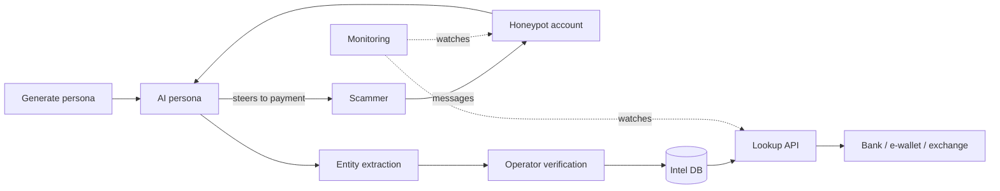

# PRD: Buru AI — Scam Intelligence Network for Southeast Asia

| Field | Value |
|---|---|
| Author | Jaxz Tan |
| Status | Baseline for v1.0 build |
| Version | 1.0 |
| Last updated | 26 Oct 2026 |
| Related | [TRD.md](TRD.md) · [buru-ai-v1-blueprint.md](buru-ai-v1-blueprint.md) · [buru-ai-v1-tasks.md](buru-ai-v1-tasks.md) |

**Revision history**

| Version | Date | Changes |
|---|---|---|
| 0.1 | 21 Oct 2026 | First draft. |
| 0.2 | 23 Oct 2026 | Aligned with TRD 0.3: confidence levels, "loan" scam type, batch lookup, persona lifecycle, Hokkien, tamper-proof audit, retention, Telegram-first decided. |
| 1.0 | 26 Oct 2026 | Renamed to Buru AI. Added §10 v1.0 release (bank demo, 2 Nov 2026). Added FR-15 one-click persona generation, NFR-9 monitoring, NFR-10 automated testing, NFR-11 deployment. Telegram fallback decision recorded. |

## 1. Problem statement

Scam syndicates in Southeast Asia run industrial-scale operations through WhatsApp, Telegram and Facebook, using parcel, job, investment, loan and "Macau" impersonation scripts that move victims' money through mule bank accounts and, increasingly, crypto wallets. Banks, e-wallets and exchanges only see the fraud *after* a customer has transferred money, and their blocklists are always behind because scammers rotate numbers, accounts and wallets weekly. Global anti-scam vendors are voice-first and built for Western markets, so they miss local languages, local scam types and the chat-to-bank-to-crypto money trail common in this region.

## 2. Goals & success metrics

| Goal | Metric | Target (6 months post-MVP) |
|---|---|---|
| Extract actionable scam intelligence | Unique mule accounts + scam wallets + scam URLs extracted per month | ≥ 1,000 |
| Personas are convincing | % of conversations where scammer reaches the "payment request" stage | ≥ 40% |
| Intelligence is useful to customers | % of API lookups returning a match that the customer confirms as true fraud | ≥ 85% precision |
| Commercial traction | Paying B2B customers (pilot or contract) | ≥ 3 |

**v1.0 goal (2 Nov 2026):** a working live demo that convinces a bank to discuss a paid pilot. See §10.

## 3. Non-goals / Out of scope (v1)

- **Voice calls** — text messaging only in v1.
- **Telco call-diversion integration** — v1 sources scammers via self-seeded honeypots.
- **Consumer app** — no B2C product; we do not protect individual users directly.
- **Automatic account freezing or takedowns** — we report; customers act.
- **Markets beyond Malaysia** — SG/ID/TH/PH come after v1.
- **Fully autonomous bots** — a human operator reviews flagged or stuck conversations.

## 4. Target users & personas

| Persona | Context | Need |
|---|---|---|
| **Farah — Fraud analyst, digital bank / e-wallet** | Reviews suspicious transfers daily; blocklists are stale. | Real-time check: "Is this recipient account linked to a scam?" |
| **Wei Ming — Risk lead, crypto exchange** | Sees deposits from scam victims and withdrawals to scam wallets. | Wallet addresses and fund-flow evidence tied to known scams. |
| **Operator (internal)** | Buru AI staff running personas and honeypots. | Create personas fast, monitor conversations, intervene, verify extracted data, know immediately when the bot is down. |

## 5. User stories & functional requirements

### Epic A — Persona engine & honeypots

| ID | User story | Priority | Acceptance criteria |
|---|---|---|---|
| FR-1 | As an operator, I want to create AI personas (age, background, language mix, wealth signals) so that scammers believe they are real victims. | Must | Persona config supports BM, English, Mandarin, Cantonese, Hokkien phrases and Manglish; each persona has consistent backstory across a conversation. Personas move through draft → active → paused → retired, and every change to a persona's prompt is kept as a new version. |
| FR-2 | As an operator, I want to connect honeypot messaging accounts (Telegram, WhatsApp) to personas so that scammers can contact them. | Must | One persona can be bound to ≥ 1 account; incoming messages route to the correct persona within 5 s. |
| FR-3 | As a persona, I want to reply with human-like timing, typos and hesitation so that scammers don't detect automation. | Must | Replies delayed by a configurable randomised range; no reply faster than 10 s. |
| FR-4 | As an operator, I want the persona to steer conversations toward payment details so that we capture mule accounts and wallets. | Must | Conversation playbooks per scam type; ≥ 40% of conversations reach payment-request stage (see Goal 2). |
| FR-5 | As an operator, I want to take over or pause any conversation so that I can handle edge cases. | Should | Takeover from dashboard in 1 click; bot stops replying immediately. Messages sent by an operator are recorded as operator messages. |
| FR-15 | As an operator, I want to generate a random, realistic persona with one click so that I can spin up new honeypots without writing backstories by hand. | Must | "Generate persona" button in the dashboard creates a complete persona (name, age, location, language mix, backstory, wealth profile, system prompt) as a `draft` in < 30 s. Each click gives a different persona. Generated personas never contain real people's identifiers. |

### Epic B — Intelligence extraction

| ID | User story | Priority | Acceptance criteria |
|---|---|---|---|
| FR-6 | As the system, I want to extract entities (bank accounts, phone numbers, crypto wallets, URLs, scammer handles) from conversations so that they become searchable intelligence. | Must | Extracted entities stored with source conversation, timestamp and a confidence level (low / medium / high). The same entity seen in several conversations is stored once, with every sighting linked to it. |
| FR-7 | As the system, I want to classify each conversation by scam type so that customers see patterns. | Must | Labels: parcel, job, investment, impersonation, romance, loan, other. |
| FR-8 | As an analyst, I want crypto wallets traced on-chain so that I can see where scam funds go. | Should | For USDT (TRON, Ethereum) wallets, show 1–2 hops of outgoing transfers and flag known exchange deposit addresses. |
| FR-9 | As an operator, I want to verify or reject extracted entities so that customer data stays accurate. | Must | Entities have status: unverified / verified / rejected. Automatic extraction can reach "medium" confidence at most; only operator verification sets "high", so only verified entities return "high confidence" in the API. |

### Epic C — Customer delivery

| ID | User story | Priority | Acceptance criteria |
|---|---|---|---|
| FR-10 | As a fraud analyst, I want a lookup API ("is this account / wallet / number / URL linked to a scam?") so that I can check before a transfer completes. | Must | Single lookup responds in < 300 ms p95 with match, confidence, scam type, first/last seen and number of sightings. Batch lookup accepts up to 100 entities per request. |
| FR-11 | As a fraud analyst, I want a dashboard of new scam entities and trends so that I can update internal rules. | Should | Filter by entity type, scam type, date; export CSV. |
| FR-12 | As a fraud analyst, I want webhook alerts when a new entity matching my institution appears (e.g., a mule account at my bank) so that I can act fast. | Should | Webhook fires within 5 min of entity verification; webhooks are signed and retried on failure. |
| FR-13 | As a customer admin, I want API keys and usage stats so that I can manage integration. | Must | Create/revoke keys; view monthly lookup count. |
| FR-14 | As a fraud analyst, I want an auto-generated evidence report per entity so that I can file takedowns or police reports. | Could | PDF/markdown report with redacted conversation excerpts and timeline. |

## 6. User flow

**Intelligence pipeline (core value):**
1. Operator clicks "Generate persona" → persona "Auntie Mei, 62, retired, Penang, Hokkien + English, has savings" is created and activated.
2. Persona is bound to a honeypot Telegram account and seeded into scam channels.
3. Scammer messages persona → bot engages following the matching scam playbook.
4. Scammer asks for payment → bot asks "which account ah?" → scammer shares bank account / wallet.
5. System extracts entities and classifies scam type.
6. Operator verifies entities.
7. **Customer's fraud system calls the lookup API on an outgoing transfer → match found → transfer held.** ← most important interaction

## 7. Non-functional requirements

| ID | Category | Requirement | Rationale |
|---|---|---|---|
| NFR-1 | Performance | Lookup API p95 < 300 ms at 100 req/s. | Must fit inside a payment authorisation flow. |
| NFR-2 | Scalability | Persona engine handles ≥ 1,000 concurrent conversations. | Scale is the core of the business model. |
| NFR-3 | Security | All customer API traffic over TLS; API keys hashed at rest; per-key rate limits. | Customers are financial institutions. |
| NFR-4 | Privacy | Conversation data encrypted at rest; customer-facing outputs redact third-party personal data not needed for fraud action. Proposed retention: 24 months for entities, 12 months for raw messages (to confirm with legal). Lookup logs record that a check happened, not the value checked. | PDPA 2010 (Malaysia). |
| NFR-5 | Compliance | Legal review of honeypot operation, data sharing with financial institutions, and alignment with Bank Negara Malaysia / National Scam Response Centre reporting expectations before first paid contract. | Customers are BNM/SC-regulated; we handle financial account data. |
| NFR-6 | Localisation | Personas support BM, English, Mandarin, Cantonese, Hokkien phrases and code-switching. | Core differentiator. |
| NFR-7 | Reliability | Lookup API availability ≥ 99.5%. | Customer integration dependency. |
| NFR-8 | Auditability | Every entity is traceable to its source conversation and verifier. Messages, sightings and verification decisions cannot be edited or deleted once recorded. | Evidence quality for customers and authorities. |
| NFR-9 | Monitoring | Every public endpoint and the honeypot bot are monitored. The operator is alerted within 2 minutes if an endpoint is down or the bot stops (disconnected, crashed or silent). The dashboard shows bot status: connected yes/no, last message received, recent LLM errors. | A honeypot that is silently down captures nothing; banks will ask how we know we're up. |
| NFR-10 | Quality | Every step of the demo flow is covered by automated tests (API and UI) that run on every pull request; a pull request cannot merge with failing tests. | Small team, fast changes; prevents demo-day breakage. |
| NFR-11 | Deployment | Backend, bot and dashboard run on a server that is online 24/7, deployed from the main branch with one command or pipeline. | Honeypot must catch messages around the clock; a laptop sleeps. |

## 8. Assumptions & open questions

**Assumptions**
- Self-seeded honeypots can generate enough scammer contacts (≥ 50 conversations/week) for an MVP. If false, telco partnership moves earlier.
- Digital banks, e-wallets and exchanges will pay for an API before a large dataset exists, on a pilot basis.
- An LLM can sustain convincing multilingual personas at an acceptable cost per conversation (≤ USD 0.50).
- Customers prefer a lookup API over raw data feeds.

**Decided**

| Question | Decision | Date |
|---|---|---|
| Telegram first, WhatsApp first, or both? | Telegram first; WhatsApp after v1. | 23 Oct 2026 |
| What if the Telegram connector isn't ready for the demo? | Decision point Fri 30 Oct, 12:00. If Telegram can't receive and reply reliably, the demo uses a simple web chat page instead. | 26 Oct 2026 |
| What does the bank see in v1.0? | A live demo run by the team, followed by a sales ask. No customer self-service access in v1.0. | 26 Oct 2026 |

**Open questions**

| Question | Owner | Decide by |
|---|---|---|
| Which phone number / SIM is the honeypot account? | Team | Team meeting, before Tue 27 Oct |
| Pricing: per lookup, monthly subscription, or tiered? | Jaxz + mentor | Before bank meeting |
| Do we share intelligence with NSRC / police for free (credibility) or only via customers? | Jaxz + legal advisor | Before M3 |
| Company structure and legal advisor | Jaxz | Before M3 |
| Confirm data retention periods (24 months entities, 12 months messages). | Jaxz + legal advisor | Before M3 |

## 9. Milestones

| Milestone | Scope | Target |
|---|---|---|
| **v1.0 — Bank demo** | See §10 | **2 Nov 2026** |
| M3 — Customer pilot | FR-10 full, FR-13, NFR-1, NFR-3, NFR-5 — first pilot customer | After bank meeting |
| M4 — Pilot-to-paid | FR-8, FR-11 full, FR-12 | After M3 |
| Stretch | FR-14, WhatsApp, Singapore | After M4 |

## 10. v1.0 release — bank demo (2 Nov 2026)

**Audience:** a bank, together with our mentor, the week of 2 Nov 2026. **Format:** live demo from a laptop against the deployed server, then a sales conversation.

**What v1.0 must do (demo path):**

| # | Demo step | Requirements |
|---|---|---|
| 1 | Generate a persona with one click | FR-15, FR-1 |
| 2 | A teammate playing a scammer chats with the persona on Telegram (fallback: web chat page) | FR-2, FR-3, FR-4 |
| 3 | The operator watches the chat live and can take over | FR-5 |
| 4 | The scammer's bank account / wallet appears as an extracted entity | FR-6, FR-7 |
| 5 | The operator verifies it | FR-9 |
| 6 | A bank simulator page checks a transfer and gets a match → transfer held | FR-10 (single lookup) |
| 7 | The status page shows the bot and endpoints are healthy | NFR-9 |

Every step is covered by automated tests (NFR-10) and runs on the deployed server (NFR-11).

**In v1.0 but simplified:**
- FR-10: single lookup only; uses the shared operator token instead of per-customer keys.
- FR-11: entity list with basic filters, no trend chart or CSV.
- FR-13: not in v1.0 (no customer self-service).

**Not in v1.0:** FR-8 chain tracer, FR-12 webhooks, FR-14 evidence reports, WhatsApp, per-customer API keys, operator email + TOTP login, KMS-backed encryption.

**What we say to the bank about customisation:** the engine (personas, extraction, verification) is fixed; what's adjustable per bank is which entity types they check, the lookup response fields, batch size, alerts (webhooks) and how they connect (API or dashboard). Their requests feed v1.1.
