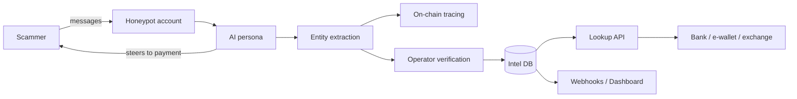

# PRD: Unknown — Scam Intelligence Network for Southeast Asia

| Field | Value |
|---|---|
| Author | Jaxz Tan |
| Status | Draft |
| Version | 0.1 |
| Last updated | 21 Oct 2026 |
| Related TRD | [TRD.md](TRD.md) |

## 1. Problem statement

Scam syndicates in Southeast Asia run industrial-scale operations through WhatsApp, Telegram and Facebook, using parcel, job, investment and "Macau" impersonation scripts that move victims' money through mule bank accounts and, increasingly, crypto wallets. Banks, e-wallets and exchanges only see the fraud *after* a customer has transferred money, and their blocklists are always behind because scammers rotate numbers, accounts and wallets weekly. Global anti-scam vendors are voice-first and built for Western markets, so they miss local languages, local scam types and the chat-to-bank-to-crypto money trail common in this region.

## 2. Goals & success metrics

| Goal | Metric | Target (6 months post-MVP) |
|---|---|---|
| Extract actionable scam intelligence | Unique mule accounts + scam wallets + scam URLs extracted per month | ≥ 1,000 |
| Personas are convincing | % of conversations where scammer reaches the "payment request" stage | ≥ 40% |
| Intelligence is useful to customers | % of API lookups returning a match that the customer confirms as true fraud | ≥ 85% precision |
| Commercial traction | Paying B2B customers (pilot or contract) | ≥ 3 |

## 3. Non-goals / Out of scope (v1)

- **Voice calls** — text messaging only in v1.
- **Telco call-diversion integration** — v1 sources scammers via self-seeded honeypots.
- **Consumer app** — no B2C product; we do not protect individual users directly.
- **Automatic account freezing or takedowns** — we report; customers act.
- **Markets beyond Malaysia** — SG/ID/TH/PH come after v1.
- **Fully autonomous bots** — a human operator reviews flagged or stuck conversations.

## 4. Target users & personas

| Persona | Context | Need |
|---|---|---|
| **Farah — Fraud analyst, digital bank / e-wallet** | Reviews suspicious transfers daily; blocklists are stale. | Real-time check: "Is this recipient account linked to a scam?" |
| **Wei Ming — Risk lead, crypto exchange** | Sees deposits from scam victims and withdrawals to scam wallets. | Wallet addresses and fund-flow evidence tied to known scams. |
| **Operator (internal)** | Unknown staff running personas and honeypots. | Monitor conversations, intervene, verify extracted data. |

## 5. User stories & functional requirements

### Epic A — Persona engine & honeypots

| ID | User story | Priority | Acceptance criteria |
|---|---|---|---|
| FR-1 | As an operator, I want to create AI personas (age, background, language mix, wealth signals) so that scammers believe they are real victims. | Must | Persona config supports BM, English, Mandarin, Cantonese, Manglish; each persona has consistent backstory across a conversation. |
| FR-2 | As an operator, I want to connect honeypot messaging accounts (Telegram, WhatsApp) to personas so that scammers can contact them. | Must | One persona can be bound to ≥ 1 account; incoming messages route to the correct persona within 5 s. |
| FR-3 | As a persona, I want to reply with human-like timing, typos and hesitation so that scammers don't detect automation. | Must | Replies delayed by a configurable randomised range; no reply faster than 10 s. |
| FR-4 | As an operator, I want the persona to steer conversations toward payment details so that we capture mule accounts and wallets. | Must | Conversation playbooks per scam type; ≥ 40% of conversations reach payment-request stage (see Goal 2). |
| FR-5 | As an operator, I want to take over or pause any conversation so that I can handle edge cases. | Should | Takeover from dashboard in 1 click; bot stops replying immediately. |

### Epic B — Intelligence extraction

| ID | User story | Priority | Acceptance criteria |
|---|---|---|---|
| FR-6 | As the system, I want to extract entities (bank accounts, phone numbers, crypto wallets, URLs, scammer handles) from conversations so that they become searchable intelligence. | Must | Extracted entities stored with source conversation, timestamp, confidence score. |
| FR-7 | As the system, I want to classify each conversation by scam type so that customers see patterns. | Must | Labels: parcel, job, investment, impersonation, romance, other. |
| FR-8 | As an analyst, I want crypto wallets traced on-chain so that I can see where scam funds go. | Should | For USDT (TRON, Ethereum) wallets, show 1–2 hops of outgoing transfers and flag known exchange deposit addresses. |
| FR-9 | As an operator, I want to verify or reject extracted entities so that customer data stays accurate. | Must | Entities have status: unverified / verified / rejected; only verified entities return "high confidence" in the API. |

### Epic C — Customer delivery

| ID | User story | Priority | Acceptance criteria |
|---|---|---|---|
| FR-10 | As a fraud analyst, I want a lookup API ("is this account / wallet / number / URL linked to a scam?") so that I can check before a transfer completes. | Must | Single lookup responds in < 300 ms p95 with match, confidence, scam type, first/last seen. |
| FR-11 | As a fraud analyst, I want a dashboard of new scam entities and trends so that I can update internal rules. | Should | Filter by entity type, scam type, date; export CSV. |
| FR-12 | As a fraud analyst, I want webhook alerts when a new entity matching my institution appears (e.g., a mule account at my bank) so that I can act fast. | Should | Webhook fires within 5 min of entity verification. |
| FR-13 | As a customer admin, I want API keys and usage stats so that I can manage integration. | Must | Create/revoke keys; view monthly lookup count. |
| FR-14 | As a fraud analyst, I want an auto-generated evidence report per entity so that I can file takedowns or police reports. | Could | PDF/markdown report with redacted conversation excerpts and timeline. |

## 6. User flow

**Intelligence pipeline (core value):**
1. Operator creates persona "Auntie Mei, 62, retired, Penang, Hokkien + English, has savings".
2. Persona is bound to honeypot Telegram/WhatsApp accounts and seeded into scam channels.
3. Scammer messages persona → bot engages following the matching scam playbook.
4. Scammer asks for payment → bot asks "which account ah?" → scammer shares bank account / wallet.
5. System extracts entities, classifies scam type, traces wallet on-chain.
6. Operator verifies entities.
7. **Customer's fraud system calls the lookup API on an outgoing transfer → match found → transfer held.** ← most important interaction

## 7. Non-functional requirements

| ID | Category | Requirement | Rationale |
|---|---|---|---|
| NFR-1 | Performance | Lookup API p95 < 300 ms at 100 req/s. | Must fit inside a payment authorisation flow. |
| NFR-2 | Scalability | Persona engine handles ≥ 1,000 concurrent conversations. | Scale is the core of the business model. |
| NFR-3 | Security | All customer API traffic over TLS; API keys hashed at rest; per-key rate limits. | Customers are financial institutions. |
| NFR-4 | Privacy | Conversation data encrypted at rest; customer-facing outputs redact third-party personal data not needed for fraud action. | PDPA 2010 (Malaysia). |
| NFR-5 | Compliance | Legal review of honeypot operation, data sharing with financial institutions, and alignment with Bank Negara Malaysia / National Scam Response Centre reporting expectations before first paid contract. | Customers are BNM/SC-regulated; we handle financial account data. |
| NFR-6 | Localisation | Personas support BM, English, Mandarin, Cantonese, Hokkien phrases and code-switching. | Core differentiator. |
| NFR-7 | Reliability | Lookup API availability ≥ 99.5%. | Customer integration dependency. |
| NFR-8 | Auditability | Every entity is traceable to its source conversation and verifier. | Evidence quality for customers and authorities. |

## 8. Assumptions & open questions

**Assumptions**
- Self-seeded honeypots can generate enough scammer contacts (≥ 50 conversations/week) for an MVP. If false, telco partnership moves earlier.
- Digital banks, e-wallets and exchanges will pay for an API before a large dataset exists, on a pilot basis.
- An LLM can sustain convincing multilingual personas at an acceptable cost per conversation (≤ USD 0.50).
- Customers prefer a lookup API over raw data feeds.

**Open questions**

| Question | Owner | Decide by |
|---|---|---|
| Telegram first, WhatsApp first, or both? (ban risk vs scam volume) | Jaxz | Before M1 |
| Pricing: per lookup, monthly subscription, or tiered? | Jaxz | Before first pilot |
| Do we share intelligence with NSRC / police for free (credibility) or only via customers? | Jaxz + legal advisor | Before M3 |
| Company structure and legal advisor | Jaxz | Before M3 |

## 9. Milestones

| Milestone | Scope | Target |
|---|---|---|
| M1 — Persona prototype | FR-1, FR-2, FR-3 (Telegram, 3 personas) | Week 4 |
| M2 — Intelligence MVP | FR-4, FR-5, FR-6, FR-7, FR-9 + internal dashboard | Week 10 |
| M3 — Customer pilot | FR-10, FR-13, NFR-1, NFR-3, NFR-5 — first pilot customer | Week 16 |
| M4 — Pilot-to-paid | FR-8, FR-11, FR-12 | Week 24 |
| Stretch | FR-14, WhatsApp scale-out, Singapore | After M4 |
