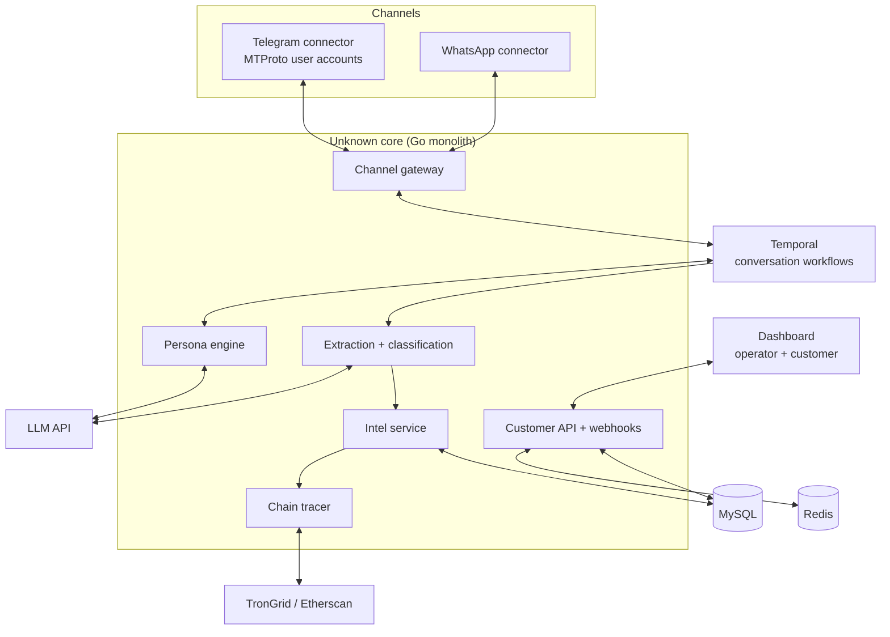

# TRD: Unknown — Scam Intelligence Network for Southeast Asia

| Field | Value |
|---|---|
| Author | Jaxz Tan |
| Status | Draft |
| Version | 0.1 |
| Last updated | 21 Oct 2026 |
| Related PRD | [PRD.md](PRD.md) |

## 1. Overview & scope

Unknown is a Go backend that runs multilingual AI personas on honeypot messaging accounts, extracts scam entities (bank accounts, wallets, phone numbers, URLs) from conversations, traces crypto wallets on-chain, and serves verified intelligence to banks, e-wallets and exchanges through a low-latency lookup API, webhooks and a dashboard. This TRD covers all PRD Must and Should requirements (FR-1 to FR-13, NFR-1 to NFR-8). FR-14 (evidence reports), voice, and telco call diversion are deferred.

## 2. Architecture

Modular monolith in Go, with long-running conversations orchestrated as Temporal workflows. Split into services only when a module's load demands it (the persona engine and lookup API are the likely first splits).



| Component | Responsibility |
|---|---|
| Channel gateway | Normalises inbound/outbound messages from all channels into one message format. |
| Telegram / WhatsApp connectors | Maintain sessions for honeypot accounts; send/receive messages. |
| Persona engine | Builds prompts from persona config + scam playbook + history; generates replies. |
| Temporal workflows | One workflow per conversation: human-like delays, playbook stage, operator takeover, timeouts. |
| Extraction + classification | LLM structured extraction of entities + regex validators; scam-type labelling. |
| Chain tracer | Follows USDT transfers 1–2 hops on TRON/Ethereum; tags known exchange addresses. |
| Intel service | Entity store, dedupe, verification workflow, confidence scoring. |
| Customer API + webhooks | Lookup API, API-key auth, rate limiting, webhook delivery. |
| Dashboard | Operator console (personas, live chats, verification) + customer portal (search, trends, keys). |

**Deployment:** Docker Compose on a VPS in Singapore or Malaysia for MVP; managed MySQL; Temporal Cloud or self-hosted Temporal. Move to Kubernetes only after M4.

## 3. Tech stack & rationale

| Layer | Choice | Why | Alternative considered |
|---|---|---|---|
| Backend | Go | Known stack; strong concurrency for thousands of conversations. | Node.js |
| Workflow orchestration | Temporal | Durable timers and state for long, delayed, pausable conversations. | Cron + DB state machine |
| Database | MySQL 8 | Known stack; relational fits entities, relations, audit trail. | PostgreSQL |
| Cache | Redis | Lookup API hot cache; rate limiting. | In-memory only |
| Queue | Temporal task queues (MVP); Kafka later | Avoid extra infra until volume justifies it. | Kafka from day one |
| LLM | Claude API — larger model for personas, smaller model for extraction | Strong multilingual + code-switching; structured output for extraction. | Self-hosted open model |
| Telegram | gotd/td (Go MTProto client) | User accounts behave like real people, unlike bots. | Bot API (scammers ignore bots) |
| WhatsApp | whatsmeow (Go) | Only practical Go option for personal accounts. | Official Business API (not suitable for personas) |
| Chain data | TronGrid + Etherscan APIs | USDT on TRON is dominant in SEA scams. | Paid analytics provider |
| Frontend | Next.js + Tailwind | Fast to build dashboard. | Plain React |
| Auth | Operator: email + TOTP; Customer: API keys + dashboard login | Simple, adequate for B2B MVP. | Auth0 |
| Hosting | Docker on VPS (SG/MY region) | Cheap, low latency to SEA customers. | AWS ap-southeast-1 |

## 4. Data model

| Entity | Key fields | Relations / notes |
|---|---|---|
| `persona` | id, name, age, language_mix, backstory, wealth_profile, playbook_ids, status | 1 → many `honeypot_account` |
| `honeypot_account` | id, channel (telegram/whatsapp), phone, session_ref, status (active/banned/cooldown) | belongs to `persona` |
| `conversation` | id, account_id, scammer_handle, scam_type, stage, status (bot/human/closed), started_at | 1 → many `message`; Temporal workflow id |
| `message` | id, conversation_id, direction, body (encrypted), sent_at | **Append-only** |
| `entity` | id, type (bank_account/wallet/phone/url/handle), value_normalized, bank_or_chain, confidence, status (unverified/verified/rejected), first_seen, last_seen | many ↔ many `conversation` via `entity_sighting` |
| `entity_sighting` | entity_id, conversation_id, message_id, extracted_at | **Append-only** — audit trail (NFR-8) |
| `verification` | entity_id, operator_id, decision, note, decided_at | **Append-only** |
| `chain_transfer` | id, from_wallet, to_wallet, chain, token, amount, tx_hash, ts, to_label | linked to wallet `entity` |
| `customer` | id, name, type (bank/ewallet/exchange), webhook_url, watch_rules | 1 → many `api_key` |
| `api_key` | id, customer_id, key_hash, status, created_at | |
| `lookup_log` | customer_id, entity_type, matched, latency_ms, ts | Usage + billing (FR-13) |

## 5. API design

| Method | Path | Purpose | Auth | Maps to FR |
|---|---|---|---|---|
| POST | `/v1/lookup` | Check one entity | API key | FR-10 |
| POST | `/v1/lookup/batch` | Check up to 100 entities | API key | FR-10 |
| GET | `/v1/entities` | List/filter entities, CSV export | Customer session | FR-11 |
| GET | `/v1/entities/{id}/trace` | On-chain trace for a wallet | Customer session | FR-8 |
| PUT | `/v1/webhooks` | Set webhook URL + watch rules | Customer session | FR-12 |
| POST/DELETE | `/v1/keys` | Create / revoke API keys | Customer session | FR-13 |
| GET | `/v1/usage` | Monthly lookup counts | Customer session | FR-13 |
| POST | `/internal/personas` | Create/edit persona | Operator | FR-1 |
| POST | `/internal/accounts` | Bind honeypot account | Operator | FR-2 |
| POST | `/internal/conversations/{id}/takeover` | Pause bot / take over | Operator | FR-5 |
| POST | `/internal/entities/{id}/verify` | Verify / reject entity | Operator | FR-9 |
| WS | `/internal/live` | Live conversation stream (`message.new`, `entity.extracted`) | Operator | FR-5, FR-9 |

**Example — `POST /v1/lookup`**

```json
// request
{ "type": "bank_account", "value": "1234567890", "bank": "MBB" }

// response
{
  "match": true,
  "confidence": "high",
  "scam_types": ["job", "investment"],
  "first_seen": "2026-09-02T10:14:00Z",
  "last_seen": "2026-10-19T08:41:00Z",
  "sightings": 7
}
```

## 6. Technical requirements

| ID | Requirement | Implements | Notes |
|---|---|---|---|
| TR-1 | Persona config schema with language mix, backstory, wealth profile; injected into system prompt with conversation history. | FR-1, NFR-6 | Store prompts versioned. |
| TR-2 | Channel connectors for Telegram (MTProto) and WhatsApp, normalised by gateway; route by account → persona. | FR-2 | Session secrets in secret store. |
| TR-3 | Temporal workflow per conversation with randomised reply delay (min 10 s), typing simulation and inactivity timeout. | FR-3, NFR-2 | Durable timers survive restarts. |
| TR-4 | Scam playbooks as stage machines (rapport → bait → payment request → stall); stage stored on conversation. | FR-4 | Playbook per scam type. |
| TR-5 | Takeover signal to workflow halts bot replies instantly; operator messages sent via same gateway. | FR-5 | Temporal signals. |
| TR-6 | Extraction pipeline: LLM structured output + validators (bank account length per bank, TRON/ETH address checksum, URL normalisation); dedupe on normalised value. | FR-6 | Runs on every inbound message. |
| TR-7 | Scam-type classifier on conversation summary; re-run at each stage change. | FR-7 | |
| TR-8 | Chain tracer job: fetch USDT transfers for wallet, follow 2 hops, label known exchange deposit addresses. | FR-8 | Rate-limit external APIs. |
| TR-9 | Verification queue in dashboard; status changes logged to append-only `verification`. | FR-9, NFR-8 | |
| TR-10 | Lookup API backed by Redis cache of verified entities (normalised keys); MySQL fallback. | FR-10, NFR-1 | Target p95 < 300 ms. |
| TR-11 | Dashboard entity list with filters, trend chart, CSV export. | FR-11 | |
| TR-12 | Webhook dispatcher with HMAC signatures, retries with backoff, delivery log; triggered on verification matching watch rules. | FR-12, NFR-3 | Temporal activity. |
| TR-13 | API key issuance (show once, store hash), revocation, per-key rate limits, `lookup_log` usage counts. | FR-13, NFR-3 | |
| TR-14 | Encrypt message bodies at rest (envelope encryption); redact non-essential personal data in customer outputs. | NFR-4 | |
| TR-15 | Load test: 1,000 concurrent conversation workflows; 100 req/s lookup. | NFR-1, NFR-2 | k6 + Temporal metrics. |
| TR-16 | Health checks, uptime monitoring, alerting on API errors and account bans. | NFR-7 | |
| TR-17 | Account health monitor: detect banned/limited honeypot accounts, move to cooldown, alert operator. | FR-2, NFR-7 | Ban rate is a key ops metric. |
| TR-18 | Legal review checklist recorded before customer pilot (honeypot operation, PDPA, data-sharing agreement). | NFR-5 | Non-code gate for M3. |

## 7. Security & compliance

- **Auth:** operators use email + TOTP with role-based access (operator, admin); customers use hashed API keys over TLS plus dashboard login.
- **Secrets:** channel session files, LLM keys and chain API keys kept in a secret manager (or encrypted env on VPS for MVP), never in the repo.
- **Input validation:** all customer inputs validated and normalised; scammer messages are treated as untrusted. Prompt-injection guardrails stop scammer text from changing persona instructions or leaking system details.
- **Rate limiting:** per API key in Redis; webhook endpoints signed with HMAC.
- **Data stored:** conversations, scammer identifiers, mule account numbers, wallets. Encrypted at rest; retention 24 months for entities, 12 months for raw messages (to confirm with legal).
- **Custody:** Unknown never holds, sends or receives funds. Personas never actually transfer money. This keeps the product outside payment and crypto-asset licensing scope.
- **Regulatory posture:** customers are BNM/SC-regulated, so expect vendor due-diligence (security questionnaire, data processing agreement). PDPA 2010 applies to personal data handled. Get a legal opinion on honeypot account operation and data sharing before the first pilot (TR-18).
- **Platform terms:** operating persona accounts on Telegram/WhatsApp likely breaches their terms of service; this is a business risk (see Risks), not a licensing issue.

## 8. Infrastructure & environments

| Environment | Setup |
|---|---|
| Local | Docker Compose: Go app, MySQL, Redis, Temporal dev server; LLM calls mocked or live with low limits. |
| Staging | VPS mirror of prod with test honeypot accounts and a sandbox customer. |
| Prod | Docker on VPS (SG/MY), managed MySQL, Redis, Temporal Cloud. |

- **CI/CD:** GitHub Actions — lint, test, build image, deploy to staging on merge; manual promote to prod.
- **Observability:** structured logs (JSON), Prometheus metrics + Grafana, Sentry for errors. Key dashboards: lookup latency, conversations by stage, extraction rate, account ban rate, LLM cost per conversation.

## 9. Testing strategy

| Area | Approach | Tools |
|---|---|---|
| Extraction validators | Table-driven unit tests per bank/chain format | Go `testing` |
| Persona quality | Golden-conversation evals: replay scam scripts, score realism and stage progression | Custom eval harness + LLM grader |
| Prompt injection | Adversarial scammer messages must not break persona | Eval suite |
| Workflows | Temporal test environment for delays, takeover, timeouts | Temporal Go SDK testsuite |
| Lookup API | Integration tests + load test (p95 < 300 ms @ 100 req/s) | k6 |
| Dashboard | E2E for verify flow and API key flow | Playwright |
| Webhooks | Delivery, retry, signature verification tests | Go `testing` + mock server |

## 10. Risks & mitigations

| Risk | Likelihood | Impact | Mitigation |
|---|---|---|---|
| Honeypot accounts banned by Telegram/WhatsApp | High | High | Account health monitor (TR-17), human-like behaviour, account pool rotation, diversify channels; pursue telco partnership long-term. |
| Too few scammer contacts from self-seeding | Medium | High | Seed via scam ads, job posts, Telegram groups; measure weekly; partner with an e-wallet or telco for diverted traffic. |
| Scammers detect AI personas | Medium | Medium | Continuous evals, human takeover, timing/typo realism, persona diversity. |
| LLM cost per conversation too high | Medium | Medium | Smaller model for extraction, summarised history, cap turns per stage. |
| False positives harm innocent account holders | Low | High | Only verified entities return high confidence; confidence scores; customer dispute flow. |
| Legal challenge to honeypot or data sharing | Low | High | Legal review before pilot (TR-18); clear data processing agreements. |

## 11. Estimation & sequencing

| Order | Work | Size | Milestone |
|---|---|---|---|
| 1 | Repo, Docker Compose, MySQL schema, Temporal setup | S | M1 |
| 2 | Telegram connector + gateway (TR-2) | M | M1 |
| 3 | Persona engine + conversation workflow with delays (TR-1, TR-3) | L | M1 |
| 4 | Playbooks + takeover (TR-4, TR-5) | M | M2 |
| 5 | Extraction, validators, classifier (TR-6, TR-7) | M | M2 |
| 6 | Operator dashboard + verification queue (TR-9) | M | M2 |
| 7 | Lookup API, Redis cache, API keys (TR-10, TR-13) | M | M3 |
| 8 | Security hardening, encryption, legal gate (TR-14, TR-18) | M | M3 |
| 9 | Chain tracer, customer dashboard, webhooks (TR-8, TR-11, TR-12) | L | M4 |
| 10 | WhatsApp connector, account health monitor (TR-17) | M | M4 |

**Critical path:** 2 → 3 → 4 → 5 → 7. Without convincing personas producing real entities, there is nothing to sell.
**Parallelisable:** the dashboard (6, 9) and chain tracer (9) can be built by a second person once the data model is fixed. The legal review (TR-18) should start in parallel with M2, not after.
