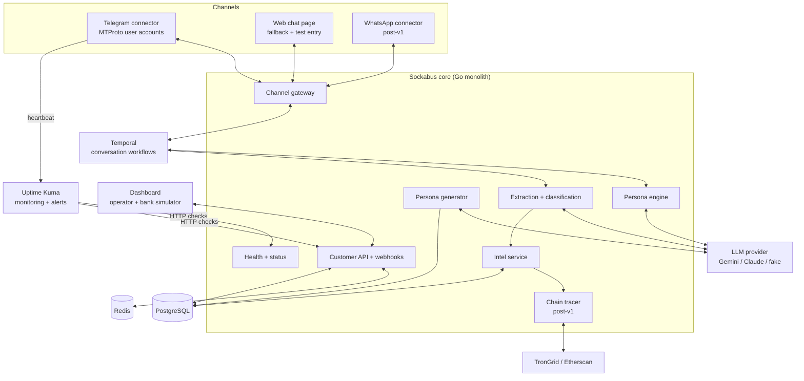

# TRD: Sockabus — Scam Intelligence Network for Southeast Asia

| Field | Value |
|---|---|
| Author | Jaxz Tan |
| Status | Baseline for v1.0 build |
| Version | 1.0 |
| Last updated | 26 Oct 2026 |
| Related | [PRD.md](PRD.md) · [buru-ai-v1-blueprint.md](buru-ai-v1-blueprint.md) · [buru-ai-v1-tasks.md](buru-ai-v1-tasks.md) |

**Revision history**

| Version | Date | Changes |
|---|---|---|
| 0.1 | 21 Oct 2026 | First draft. |
| 0.2 | 23 Oct 2026 | Database moved from MySQL 8 to PostgreSQL 15+; data access via sqlc + pgx; migrations via golang-migrate. Data model synced with schema. |
| 0.3 | 23 Oct 2026 | Fixed §2/§7 contradiction on query builders; §4 points to `db/schema.dbml` as a generated diagram; added §12 implementation gaps. |
| 0.4 | 24 Oct 2026 | LLM provider interface (Gemini default, Claude supported); migration 000004 (`personas.profile`/`demo_identifiers`, `conversations.scammer_peer_ref`, `messages.dedupe_key`, append-only triggers); G-4, G-5 closed; G-7 to G-10 added. |
| 1.0 | 26 Oct 2026 | **Correction:** 0.4 described the Telegram honeypot as live; chat currently runs through a CLI and the Telegram connector is not built (G-11). Added §13 v1.0 release scope (bank demo, 2 Nov 2026). Added persona generation endpoint (TR-19), monitoring (TR-20), automated tests in CI (TR-21), web chat fallback + dev message injection (TR-22), 24/7 deployment (TR-23). New endpoints in §5. Monitoring, testing and deployment sections rewritten for v1.0. G-11 to G-13 added. |

## 1. Overview & scope

Sockabus is a Go backend that runs multilingual AI personas on honeypot messaging accounts, extracts scam entities (bank accounts, wallets, phone numbers, URLs) from conversations, traces crypto wallets on-chain, and serves verified intelligence to banks, e-wallets and exchanges through a low-latency lookup API, webhooks and a dashboard. This TRD covers all PRD Must and Should requirements (FR-1 to FR-13, NFR-1 to NFR-8). FR-14 (evidence reports), voice, and telco call diversion are deferred.

## 2. Architecture

Modular monolith in Go, with long-running conversations orchestrated as Temporal workflows. Split into services only when a module's load demands it (the persona engine and lookup API are the likely first splits).



| Component | Responsibility |
|---|---|
| Channel gateway | Normalises inbound/outbound messages from all channels into one message format. |
| Telegram connector | Maintains sessions for honeypot user accounts; sends/receives messages; reports connection state and heartbeat. |
| Web chat page | Browser chat that talks to the gateway as a channel. Demo fallback if Telegram fails, and the entry point for automated end-to-end tests. Enabled by config only. |
| Persona generator | Generates a random, complete persona (profile + system prompt) through the LLM provider and stores it as `draft`. |
| Persona engine | Builds prompts from persona config + scam playbook + history; generates replies. |
| Temporal workflows | One workflow per conversation: human-like delays, playbook stage, operator takeover, timeouts. |
| Extraction + classification | LLM structured extraction of entities + regex validators; scam-type labelling. |
| Chain tracer | Follows USDT transfers 1–2 hops on TRON/Ethereum; tags known exchange addresses (post-v1). |
| Intel service | Entity store, dedupe, verification workflow, confidence scoring. |
| Customer API + webhooks | Lookup API, API-key auth, rate limiting, webhook delivery. |
| Health + status | `/healthz` for uptime checks; `/internal/status` for bot and LLM status shown in the dashboard. |
| Dashboard | Operator console (personas, live chats, verification, status) + bank simulator page for demos. |
| Uptime Kuma | Checks endpoints, receives bot heartbeats, sends alerts. |

**Data access:** All SQL comes from sqlc-generated queries, or a parameterised builder for dynamic filters (§7).

**Deployment:** see §8. v1.0 runs on one VPS with Docker Compose; Kubernetes only after M4.

## 3. Tech stack & rationale

| Layer | Choice | Why | Alternative considered |
|---|---|---|---|
| Backend | Go | Known stack; strong concurrency for thousands of conversations. | Node.js |
| Workflow orchestration | Temporal | Durable timers and state for long, delayed, pausable conversations. | Cron + DB state machine |
| Database | PostgreSQL 15+ | `jsonb` for persona/playbook/watch-rule config; native enums; `UNIQUE NULLS NOT DISTINCT` for entity dedupe; per-table grants to enforce append-only audit tables. | MySQL 8 |
| Data access | sqlc + pgx | Type-safe Go generated from plain SQL; every query parameterised; full control over hot lookup queries. | GORM, ent, Prisma (Go client archived Jul 2025) |
| Migrations | golang-migrate | Versioned up/down SQL files; same folder is sqlc's schema source. | Atlas |
| Cache | Redis | Lookup API hot cache; rate limiting. | In-memory only |
| Queue | Temporal task queues (MVP); Kafka later | Avoid extra infra until volume justifies it. | Kafka from day one |
| LLM | Provider interface (`internal/llm`). Default: Gemini 3.8 Flash (`gemini-3.8-flash`, thinking level low) for personas and extraction; Claude API supported via `SOCKABUS_LLM_PROVIDER=anthropic` | Swap providers by config; personas, extraction and the persona generator never call a vendor SDK directly. | Self-hosted open model |
| Telegram | gotd/td (Go MTProto client) | User accounts behave like real people, unlike bots. | Bot API (scammers ignore bots) |
| WhatsApp | whatsmeow (Go) | Only practical Go option for personal accounts. | Official Business API (not suitable for personas) |
| Chain data | TronGrid + Etherscan APIs | USDT on TRON is dominant in SEA scams. | Paid analytics provider |
| Frontend | Next.js + Tailwind (existing operator dashboard) | Fast to build. Talks only to the Go API, never directly to the database. | Plain React |
| Auth | v1.0: shared operator bearer token. Target: operator email + TOTP; customer API keys + dashboard login | Token is enough for a team-run demo (G-7). | Auth0 |
| Monitoring | v1.0: Uptime Kuma (HTTP checks, push heartbeats, Telegram/email alerts). Later: Prometheus + Grafana + Sentry | One container covers "is it up, is the bot alive" this week. | Prometheus stack from day one |
| Testing | Go `testing`; Playwright Test (`@playwright/test`) for API + UI; `playwright-cli` for agent-driven exploratory UI checks | One test framework for API and UI; CLI lets coding agents check screens cheaply. | Cypress |
| Hosting | One VPS (SG/MY region), Docker Compose, Caddy reverse proxy with automatic HTTPS | Cheap, always-on, low latency to SEA. | AWS ap-southeast-1 |

## 4. Data model

PostgreSQL 15+. All timestamps are `timestamptz` (UTC). Migrations under `db/migrations` are the source of truth; `db/schema.dbml` is a diagram of them for viewing in dbdiagram.io. After changing migrations, regenerate it instead of editing it by hand:

```bash
npx @dbml/cli db2dbml postgres "$DATABASE_URL" -o db/schema.dbml
```

**Operators, personas and accounts**

| Entity | Key fields | Relations / notes |
|---|---|---|
| `operators` | id, email, role (operator/admin), totp_secret_ref, created_at | Referenced by prompt versions, messages, verifications |
| `personas` | id, name, age, language_mix (jsonb), backstory, wealth_profile (jsonb), profile (jsonb), demo_identifiers (jsonb, masked), status (draft/active/paused/retired) | 1 → many `honeypot_accounts`; many ↔ many `playbooks`. `profile` holds persona-generator fields; demo identifiers are masked and never placed in a prompt |
| `persona_prompt_versions` | id, persona_id, version, system_prompt, created_by, created_at | Unique (persona_id, version) — TR-1. Generator writes version 1 |
| `playbooks` | id, scam_type, name, version, stages (jsonb) | Stage machine per scam type — TR-4 |
| `persona_playbooks` | persona_id, playbook_id | Join table |
| `honeypot_accounts` | id, persona_id, channel (telegram/whatsapp/webchat), phone, session_ref, status (active/banned/cooldown), banned_at, cooldown_until | belongs to `personas` — TR-17. `webchat` channel added for the fallback/test channel |

**Conversations**

| Entity | Key fields | Relations / notes |
|---|---|---|
| `conversations` | id, account_id, playbook_id, temporal_workflow_id, scammer_handle, scammer_peer_ref, scam_type, stage, status (bot/human/closed), started_at, last_message_at, closed_at | 1 → many `messages`. `scammer_peer_ref` is the channel reply address (Telegram: user id + access hash; web chat: session id) |
| `messages` | id, conversation_id, direction, sender_type (scammer/persona/operator), operator_id, body_ciphertext (bytea), dek_ref, sent_at, dedupe_key | **Append-only** (grants + triggers). Encrypted — TR-14. `dedupe_key` makes redelivered updates and retried sends idempotent |

**Intelligence**

| Entity | Key fields | Relations / notes |
|---|---|---|
| `entities` | id, type (bank_account/wallet/phone/url/handle), value_normalized, bank_or_chain, confidence (low/medium/high), status (unverified/verified/rejected), sightings_count, first_seen, last_seen | Unique (type, value_normalized, bank_or_chain) `NULLS NOT DISTINCT`. many ↔ many `conversations` via `entity_sightings` |
| `entity_sightings` | id, entity_id, conversation_id, message_id, extracted_at | **Append-only** — audit trail (NFR-8). Unique (entity_id, message_id) |
| `verifications` | id, entity_id, operator_id, decision (verified/rejected), note, decided_at | **Append-only** |
| `chain_transfers` | id, wallet_entity_id, chain (tron/ethereum), token, tx_hash, log_index, from_wallet, to_wallet, amount (numeric 38,18), hop, to_label, ts | Unique (chain, tx_hash, log_index, wallet_entity_id). Post-v1 |

**Customers**

| Entity | Key fields | Relations / notes |
|---|---|---|
| `customers` | id, name, type (bank/ewallet/exchange), webhook_url, webhook_secret_ref, watch_rules (jsonb) | 1 → many `api_keys`, `customer_users` |
| `customer_users` | id, customer_id, email, password_hash | Dashboard login (post-v1) |
| `api_keys` | id, customer_id, key_prefix, key_hash, status (active/revoked), rate_limit_per_min, created_at, revoked_at | Post-v1 (G-7) |
| `lookup_logs` | id, customer_id, api_key_id, entity_type, matched, latency_ms, ts | Usage + billing (FR-13). Does not store the looked-up value |
| `webhook_deliveries` | id, customer_id, entity_id, event_type, payload (jsonb), status (pending/delivered/failed), attempts, last_response_code, created_at, delivered_at | Delivery log — TR-12. Post-v1 |

**Design notes**

- `sightings_count` is denormalised on `entities` so the lookup API never counts sightings at request time.
- `entities.confidence` is an enum. Extractor scores alone can reach at most `medium`; only an operator verification sets `high`.
- Secrets (session files, TOTP secrets, webhook secrets) are stored only as `*_ref` pointers to the secret store.
- Redis cache and Temporal workflow state live outside PostgreSQL; `conversations.temporal_workflow_id` links them.
- Adding `webchat` to the channel enum needs a new migration (`ALTER TYPE ... ADD VALUE`).

## 5. API design

| Method | Path | Purpose | Auth | Maps to | v1.0 |
|---|---|---|---|---|---|
| GET | `/healthz` | Liveness: app, DB, Redis, Temporal reachable | None | NFR-9 | ✅ |
| GET | `/internal/status` | Bot + LLM status for dashboard | Operator | NFR-9 | ✅ |
| POST | `/internal/personas/generate` | Generate a random persona (draft) | Operator | FR-15 | ✅ |
| GET | `/internal/personas` | List personas | Operator | FR-1 | ✅ |
| POST | `/internal/personas` | Create/edit persona | Operator | FR-1 | ✅ |
| PATCH | `/internal/personas/{id}/status` | Activate / pause / retire | Operator | FR-1 | ✅ |
| POST | `/internal/accounts` | Bind honeypot account | Operator | FR-2 | ✅ |
| GET | `/internal/conversations` | List conversations | Operator | FR-5 | ✅ |
| GET | `/internal/conversations/{id}/messages` | Messages of one conversation (decrypted for operator) | Operator | FR-5 | ✅ |
| POST | `/internal/conversations/{id}/takeover` | Pause bot / take over | Operator | FR-5 | ✅ |
| POST | `/internal/conversations/{id}/messages` | Operator sends a message after takeover | Operator | FR-5 | ✅ |
| GET | `/internal/entities` | List entities with filters | Operator | FR-9, FR-11 | ✅ |
| POST | `/internal/entities/{id}/verify` | Verify / reject entity | Operator | FR-9 | ✅ |
| WS | `/internal/live` | Live stream (`message.new`, `entity.extracted`) | Operator | FR-5, FR-9 | ⚠ polling acceptable in v1.0 |
| POST | `/internal/dev/inject` | Inject a scammer message into the gateway (web chat + tests) | Operator, only when `BURU_DEV_INJECT=true` | TR-22 | ✅ |
| POST | `/v1/lookup` | Check one entity | API key (v1.0: shared token) | FR-10 | ✅ |
| POST | `/v1/lookup/batch` | Check up to 100 entities | API key | FR-10 | ❌ |
| GET | `/v1/entities` | List/filter entities, CSV export | Customer session | FR-11 | ❌ |
| GET | `/v1/entities/{id}/trace` | On-chain trace for a wallet | Customer session | FR-8 | ❌ |
| PUT | `/v1/webhooks` | Set webhook URL + watch rules | Customer session | FR-12 | ❌ |
| POST/DELETE | `/v1/keys` | Create / revoke API keys | Customer session | FR-13 | ❌ |
| GET | `/v1/usage` | Monthly lookup counts | Customer session | FR-13 | ❌ |

All v1.0 endpoints are specified in `api/openapi.yaml`; the mock server is generated from it.

**Example — `POST /internal/personas/generate`**

```json
// request (all fields optional; omitted = random)
{ "scam_type_hint": "investment", "language_hint": "zh+en" }

// response 201
{
  "id": 42,
  "status": "draft",
  "name": "Mei Ling",
  "age": 62,
  "location": "Penang",
  "language_mix": { "en": 0.5, "hokkien": 0.3, "ms": 0.2 },
  "backstory": "Retired school clerk, widowed, two children in Singapore...",
  "wealth_profile": { "savings_band": "RM100k-300k", "tech_savvy": "low" },
  "prompt_version": 1
}
```

**Example — `GET /internal/status`**

```json
{
  "telegram": { "connected": true, "accounts_active": 1, "last_message_at": "2026-10-30T08:41:00Z" },
  "llm": { "provider": "gemini", "errors_last_15m": 0 },
  "workflows_running": 3
}
```

**Example — `POST /v1/lookup`**

```json
// request
{ "type": "bank_account", "value": "1234567890", "bank": "MBB" }

// response
{
  "match": true,
  "confidence": "high",
  "scam_types": ["job", "investment"],
  "first_seen": "2026-09-02T10:14:00Z",
  "last_seen": "2026-10-19T08:41:00Z",
  "sightings": 7
}
```

## 6. Technical requirements

| ID | Requirement | Implements | Notes |
|---|---|---|---|
| TR-1 | Persona config schema with language mix, backstory, wealth profile; injected into system prompt with conversation history. | FR-1, NFR-6 | Prompts versioned in `persona_prompt_versions`. |
| TR-2 | Channel connectors for Telegram (MTProto) and WhatsApp, normalised by gateway; route by account → persona. | FR-2 | Session secrets in secret store. v1.0: Telegram only (G-11). |
| TR-3 | Temporal workflow per conversation with randomised reply delay (min 10 s), typing simulation and inactivity timeout. | FR-3, NFR-2 | Durable timers survive restarts. Delay configurable so tests can shorten it. |
| TR-4 | Scam playbooks as stage machines (rapport → bait → payment request → stall); stage stored on conversation. | FR-4 | Playbook per scam type. |
| TR-5 | Takeover signal to workflow halts bot replies instantly; operator messages sent via same gateway. | FR-5 | Temporal signals. |
| TR-6 | Extraction pipeline: LLM structured output + validators (bank account length per bank, TRON/ETH address checksum, URL normalisation); dedupe on normalised value. | FR-6 | Runs on every inbound message. |
| TR-7 | Scam-type classifier on conversation summary; re-run at each stage change. | FR-7 | |
| TR-8 | Chain tracer job: fetch USDT transfers for wallet, follow 2 hops, label known exchange deposit addresses. | FR-8 | Post-v1. |
| TR-9 | Verification queue in dashboard; status changes logged to append-only `verifications`. | FR-9, NFR-8 | |
| TR-10 | Lookup API backed by Redis cache of verified entities (normalised keys); PostgreSQL fallback. | FR-10, NFR-1 | Target p95 < 300 ms. |
| TR-11 | Dashboard entity list with filters, trend chart, CSV export. | FR-11 | v1.0: list + basic filters only. |
| TR-12 | Webhook dispatcher with HMAC signatures, retries with backoff, delivery log in `webhook_deliveries`. | FR-12, NFR-3 | Post-v1. |
| TR-13 | API key issuance (show once, store hash), revocation, per-key rate limits, `lookup_logs` usage counts. | FR-13, NFR-3 | Post-v1. |
| TR-14 | Encrypt message bodies at rest (envelope encryption); redact non-essential personal data in customer outputs. | NFR-4 | v1.0: single local key (G-8). |
| TR-15 | Load test: 1,000 concurrent conversation workflows; 100 req/s lookup. | NFR-1, NFR-2 | Post-v1. |
| TR-16 | Health checks, uptime monitoring, alerting on API errors and account bans. | NFR-7, NFR-9 | Implemented via TR-20 in v1.0. |
| TR-17 | Account health monitor: detect banned/limited honeypot accounts, move to cooldown, alert operator. | FR-2, NFR-7 | v1.0: alert via heartbeat loss; auto status change post-v1 (G-10). |
| TR-18 | Legal review checklist recorded before customer pilot. | NFR-5 | Non-code gate for M3. |
| TR-19 | Persona generator: `POST /internal/personas/generate` calls the LLM provider with the persona-generator prompt and JSON schema (ported from the persona skill into `internal/persona/generator`), validates the output, stores a `draft` persona + prompt version 1. Randomness from seeded attributes (age band, state, language mix, scam-type hint) chosen in Go before the LLM call, so each click differs. | FR-15 | Output validated against schema; invalid output retried once, then 502. Never includes real identifiers. |
| TR-20 | Monitoring: `/healthz` checks DB, Redis, Temporal; Telegram connector pushes a heartbeat to Uptime Kuma every 60 s while connected; Kuma HTTP monitors on `/healthz`, `/v1/lookup` (synthetic request) and the dashboard; alerts to the team Telegram group/email; `/internal/status` feeds a dashboard status page. | NFR-9, TR-16, TR-17 | Alert within 2 min = heartbeat interval 60 s + 1 retry. |
| TR-21 | Automated tests in CI: Go unit tests, Playwright API tests and Playwright UI tests run on every pull request in GitHub Actions against the Docker Compose stack with `BURU_LLM_PROVIDER=fake`; branch protection blocks merging on failure. | NFR-10 | See §9 for layers and test cases. |
| TR-22 | Web chat channel: a page in the dashboard that sends messages through `/internal/dev/inject` and shows persona replies. Acts as the demo fallback and the test entry point. Enabled only when `BURU_DEV_INJECT=true`. | FR-2, NFR-10 | Decision point for using it in the demo: Fri 30 Oct 12:00. |
| TR-23 | Deployment: one VPS runs the full Compose stack (app, PostgreSQL, Redis, Temporal, dashboard, Caddy, Uptime Kuma); `make deploy` (or a manual GitHub Actions workflow) pulls `main`, runs migrations, restarts containers; secrets in a `.env` on the server only. | NFR-11 | Daily PostgreSQL dump to off-server storage. |

## 7. Security & compliance

- **Auth:** target is operators with email + TOTP and role-based access, customers with hashed API keys plus dashboard login. v1.0 uses a single operator bearer token (G-7); the dashboard and API are not shared with anyone outside the team.
- **Secrets:** channel session files, LLM keys, Telegram `api_id`/`api_hash` and chain API keys kept in a secret manager (or `.env` on the VPS only for v1.0), never in the repo.
- **Input validation:** all customer inputs validated and normalised; scammer messages are treated as untrusted. Prompt-injection guardrails stop scammer text from changing persona instructions or leaking system details. All database access goes through sqlc-generated parameterised queries, or a parameterised builder (e.g. squirrel) for dynamic dashboard filters; string-built SQL is not allowed.
- **Dev endpoints:** `/internal/dev/inject` is disabled unless `BURU_DEV_INJECT=true` and always requires the operator token.
- **Append-only enforcement:** the application's database role has INSERT and SELECT only on `messages`, `entity_sightings` and `verifications`; triggers block UPDATE/DELETE.
- **Rate limiting:** per API key in Redis; webhook endpoints signed with HMAC.
- **Data stored:** conversations, scammer identifiers, mule account numbers, wallets. Encrypted at rest; retention 24 months for entities, 12 months for raw messages (to confirm with legal).
- **Custody:** Sockabus never holds, sends or receives funds. Personas never actually transfer money. This keeps the product outside payment and crypto-asset licensing scope.
- **Regulatory posture:** customers are BNM/SC-regulated, so expect vendor due-diligence (security questionnaire, data processing agreement). PDPA 2010 applies to personal data handled. Get a legal opinion on honeypot account operation and data sharing before the first pilot (TR-18).
- **Platform terms:** operating persona accounts on Telegram/WhatsApp likely breaches their terms of service; this is a business risk (see Risks), not a licensing issue. v1.0 demo uses a teammate as the scammer.

## 8. Infrastructure & environments

| Environment | Setup |
|---|---|
| Local | Docker Compose: Go app, PostgreSQL, Redis, Temporal dev server, dashboard; `BURU_LLM_PROVIDER=fake` by default, live provider optional. |
| CI | GitHub Actions: same Compose stack, fake LLM, all tests (§9). |
| Prod (v1.0) | One VPS (SG/MY): Compose stack + Caddy (HTTPS) + Uptime Kuma. Temporal self-hosted in Compose. Live LLM provider. Staging environment and Temporal Cloud after v1.0. |

- **Repo layout (data):** `db/migrations`, `db/queries`, `db/schema.dbml` (generated), `sqlc.yaml` (engine `postgresql`, `sql_package: pgx/v5`).
- **Repo layout (API + tests):** `api/openapi.yaml` (contract + mock source), `tests/api/` (Playwright API tests), `tests/ui/` (Playwright UI tests), `playwright.config.ts` (`baseURL` from env so the same tests hit mock, local or prod).
- **CI/CD:** GitHub Actions on every PR — lint, `go test`, `sqlc diff`, `sqlc vet`, migrations up/down, Compose up, Playwright API + UI tests, upload HTML report on failure. Merge to `main` is blocked on failure. Deploy is a manual workflow or `make deploy` on the VPS.
- **Monitoring (v1.0):** Uptime Kuma monitors — HTTP `/healthz` (60 s), HTTP synthetic `/v1/lookup` (60 s), HTTP dashboard (60 s), Push heartbeat from Telegram connector (60 s). Notifications to the team Telegram group and email. Dashboard status page reads `/internal/status`.
- **Observability (later):** Prometheus + Grafana, Sentry; dashboards for lookup latency, conversations by stage, extraction rate, ban rate, LLM cost per conversation.
- **Backups:** nightly `pg_dump` to off-server storage; restore tested once before the bank demo.

## 9. Testing strategy

**Layers**

| Layer | Tool | Scope | Runs |
|---|---|---|---|
| Unit | Go `testing` | Extraction validators, confidence mapping, persona generator schema validation, playbook stage transitions | Every PR |
| Workflow | Temporal Go SDK testsuite | Delays, takeover, timeouts | Every PR |
| Database | testcontainers-go + golang-migrate | Queries against real PostgreSQL; append-only triggers | Every PR |
| API | Playwright Test (`request` fixture) | Every v1.0 endpoint in §5: happy path + auth failure + bad input | Every PR; against mock from day 2, real stack from day 5 |
| UI regression | Playwright Test (browser) | Demo flow end-to-end through the web chat channel | Every PR |
| UI exploration | `playwright-cli` + coding agent | Click through screens, find broken states, generate starter test code | On demand, before merging UI work |
| Persona quality | Golden-conversation evals with live LLM | Replay the 3 golden scam scripts; check stage progression and that an entity is extracted | Manual, before demo |
| Prompt injection | Adversarial scammer messages | Persona must not break or leak instructions | Manual, before demo |

**Rules**
- CI uses `BURU_LLM_PROVIDER=fake`; tests assert on structure (reply exists, entity extracted, status changed), never on exact LLM wording.
- Reply delay is shortened by config in CI (`BURU_REPLY_DELAY_MIN=0`).
- UI elements used by tests carry agreed `data-testid` attributes (list in the blueprint); a screen is not done until they exist.
- Telegram itself is not automated; the web chat channel exercises the same gateway path.

**Demo-path test cases** — the full list with IDs (TC-1 to TC-22) lives in [buru-ai-v1-blueprint.md](buru-ai-v1-blueprint.md) §8.

## 10. Risks & mitigations

| Risk | Likelihood | Impact | Mitigation |
|---|---|---|---|
| Telegram connector not working by demo | Medium | High | Decision point Fri 30 Oct 12:00; web chat fallback (TR-22) built anyway because tests need it. |
| Honeypot accounts banned by Telegram/WhatsApp | High | High | Heartbeat alert (TR-20), human-like behaviour, account pool rotation, diversify channels; pursue telco partnership long-term. |
| Too few scammer contacts from self-seeding | Medium | High | Seed via scam ads, job posts, Telegram groups; measure weekly; partner with an e-wallet or telco for diverted traffic. |
| Scammers detect AI personas | Medium | Medium | Continuous evals, human takeover, timing/typo realism, persona diversity. |
| LLM cost per conversation too high | Medium | Medium | Smaller model for extraction, summarised history, cap turns per stage. |
| LLM outage during demo | Low | High | Provider switch by config (Gemini ↔ Claude); test both before demo. |
| False positives harm innocent account holders | Low | High | Only verified entities return high confidence; customer dispute flow. |
| Legal challenge to honeypot or data sharing | Low | High | Legal review before pilot (TR-18); clear data processing agreements. |
| Team capacity (2 experienced devs, 3 new) | High | Medium | Small scoped tasks for new members, templates, daily standup; see tasks file. |

## 11. Estimation & sequencing

| Order | Work | Size | Milestone |
|---|---|---|---|
| 1 | Repo, Docker Compose, PostgreSQL migrations, sqlc setup, Temporal setup | S | Done (verify in audit) |
| 2 | Telegram connector + gateway (TR-2) | M | v1.0 |
| 3 | Persona engine + conversation workflow with delays (TR-1, TR-3) | L | Done for CLI (auto-reply) |
| 4 | Persona generator endpoint + button (TR-19) | S | v1.0 |
| 5 | Playbooks + takeover (TR-4, TR-5) | M | v1.0 (verify in audit) |
| 6 | Extraction, validators, classifier (TR-6, TR-7) | M | v1.0 (verify in audit) |
| 7 | Operator dashboard + verification queue + status page (TR-9, TR-20) | M | v1.0 |
| 8 | Web chat channel + dev inject (TR-22) | S | v1.0 |
| 9 | Monitoring + deployment (TR-20, TR-23) | S | v1.0 |
| 10 | Automated tests in CI (TR-21) | M | v1.0 |
| 11 | Lookup API cache, API keys (TR-10, TR-13) | M | M3 |
| 12 | Security hardening, encryption, legal gate (TR-14, TR-18) | M | M3 |
| 13 | Chain tracer, customer dashboard, webhooks (TR-8, TR-11, TR-12) | L | M4 |
| 14 | WhatsApp connector, account health automation (TR-17) | M | M4 |

**Critical path for v1.0:** 2 → (5, 6 verified) → 7 → demo rehearsal. **Day-by-day plan and owners:** [buru-ai-v1-tasks.md](buru-ai-v1-tasks.md).

## 12. Open implementation gaps (doc ahead of code)

This section tracks where the code still differs from this TRD. Delete each row once it is done.

| # | Gap | Current code | Target | Done when |
|---|---|---|---|---|
| G-6 | Schema diagram | `db/schema.dbml` hand-copied from design | Regenerated from real migrations with `db2dbml` | File matches applied migrations |
| G-7 | Operator auth | Live operator API and `/v1/lookup` use one bearer token (`SOCKABUS_OPERATOR_TOKEN`) mapped to `SOCKABUS_OPERATOR_ID` | Operators: email + TOTP with roles; customers: hashed API keys (FR-13, M3) | Token removed |
| G-8 | Envelope encryption | AES-256-GCM with one key from `SOCKABUS_MESSAGE_KEY`; `dek_ref = local:v1` | Per-conversation data keys wrapped by a KMS (TR-14, M3) | Rows re-encrypted or readable under both refs |
| G-9 | Telegram update state | gotd update state and access hashes are in memory; messages sent while the app is down are not replayed | Persistent state storage per account (e.g. bbolt or PostgreSQL) | Restart replays missed messages |
| G-10 | Account health | Connector stops an account on `AUTH_KEY_UNREGISTERED` / `USER_DEACTIVATED*` and logs it | TR-17: set status `banned`/`cooldown` and alert the operator (M4) | Status changes automatically |
