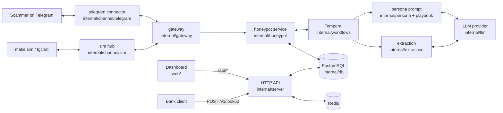
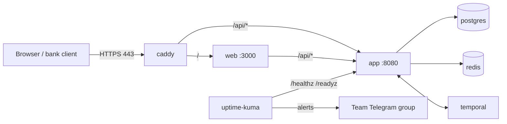

# Architecture

How Buru AI is built today, and what the v1.0 target adds. The design intent lives in [TRD.md](TRD.md) §2; this file tracks the code. Deployment work is tracked in [plan.md](plan.md).

## Shape

A modular monolith in Go. One binary (`cmd/sockabus`) runs the HTTP API and the Temporal worker. Each long-running scam conversation is one Temporal workflow. The Next.js dashboard (`web/`) talks only to the Go API, never to the database.

`SOCKABUS_MODE` picks one of two runtimes:

| Mode | What runs | Storage |
|---|---|---|
| `demo` (default) | In-memory pitch demo with a scripted scammer simulator (`internal/engine`, `internal/demostore`) | In memory, seeded from `internal/demostore/seed.json` |
| `live` | Real honeypot: Telegram connector → conversation workflows → persona LLM | PostgreSQL, Redis, Temporal |

## Live data flow

1. A scammer messages a honeypot account. The Telegram connector (or the sim hub, for testing without Telegram) receives it.
2. The gateway normalises the message and hands it to the honeypot service, which stores it and signals the conversation workflow.
3. The workflow waits a human-like delay, builds the persona prompt (persona + playbook stage + history) and asks the LLM for a reply.
4. Extraction pulls entities (bank accounts, wallets, phones, URLs) out of the conversation and labels the scam type.
5. Operators see conversations, take over, and verify entities in the dashboard. Banks query verified entities through `POST /v1/lookup`.

## Packages

| Package | Role | State |
|---|---|---|
| `cmd/sockabus` | Main binary: API + Temporal worker | Built |
| `cmd/tglogin`, `cmd/tgchat`, `cmd/simchat`, `cmd/demo` | Dev tools: log in a honeypot number, play the scammer, chat without Telegram, demo runner | Built |
| `internal/channel/telegram` | MTProto user-account connector (gotd/td) | Built |
| `internal/channel/sim` | In-process channel for testing without Telegram | Built |
| `internal/gateway` | Channel registry and message normalisation | Built |
| `internal/honeypot` | Accounts, conversations, Temporal activities | Built |
| `internal/workflows` | One workflow per conversation: delays, takeover, close | Built |
| `internal/persona` | Persona prompts and the persona generator | Built |
| `internal/playbook` | Scam-type stage machines | Built |
| `internal/llm` | Provider interface: Gemini (default), Anthropic, retry | Built |
| `internal/extraction` | LLM structured extraction + regex validators | Built |
| `internal/msgcrypt` | Message encryption at rest | Built |
| `internal/db` | sqlc-generated queries from `db/migrations` + `db/queries` | Built |
| `internal/server` | HTTP routes for both modes, auth, `/healthz`, `/readyz` | Built |
| `internal/config` | Env config (`SOCKABUS_*`) | Built |
| `internal/engine`, `internal/demostore` | Demo-mode engine and seed data | Built |
| `internal/intel` | Entity dedupe, verification, confidence scoring (TR-9) | Stub (`doc.go` only) |
| `internal/tracer` | USDT tracing on TRON/Ethereum (TR-8) | Stub (`doc.go` only) |
| `internal/customerapi` | API keys, usage, webhooks (TR-10, TR-12, TR-13) | Stub (`doc.go` only) |

## HTTP API

Routes live in `internal/server`. Full contract: [TRD.md](TRD.md) §5.

| Prefix | Who calls it | Examples |
|---|---|---|
| `/healthz`, `/readyz` | Uptime checks | Liveness, dependency readiness |
| `/v1/*` | Banks and customers | `POST /v1/lookup` |
| `/internal/*` | Dashboard (operators) | Personas, generate personas, accounts, conversations, takeover, operator message, close |

## Frontend

- `web/`: Next.js + Tailwind dashboard. Pages under `web/src/app`: `conversations`, `personas`, `entities`, `verify`, `status`, `demo`. In Docker, it proxies `/api/*` to `http://app:8080`.
- `front-end/sockabus-console`: static HTML/CSS console prototype, plus the spec in `front-end/Sockabus-Frontend-Spec-v1.1.md`.

## Data

PostgreSQL 16. Migrations in `db/migrations` are the source of truth; sqlc generates `internal/db` from them. Schema details: [TRD.md](TRD.md) §4. Redis holds the lookup cache and rate limits.

## Deployment

**Today (local):** `docker-compose.yml` runs `postgres`, `redis` and `temporal` (in-memory dev server). The `app` and `web` containers start with `--profile app`. Details: [docker.md](docker.md).

**v1.0 target (TRD §8, TR-23):** one VPS in SG/MY running the same stack, plus Caddy and Uptime Kuma.

Not built yet: Caddy, Uptime Kuma, a Temporal setup that keeps its data, `make deploy`, and nightly `pg_dump`. See [plan.md](plan.md).
